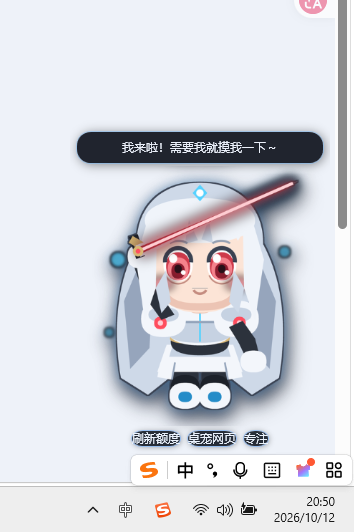

# dsh-desktop-pet · DeepSeek Harness 桌宠

> 一个真正贴在 Windows 桌面上的桌宠插件：任务完成会提醒你，需要你操作时会叫你，顺便盯着你的 DeepSeek 开放平台余额。



> 上图是真实截图：Q 版形象、逐像素透明（桌面壁纸直接透出来）、永久置顶，下方三个按钮是 `刷新额度 / 桌宠网页 / 专注`——直接在桌面上点，不用切窗口。

---

## 它解决什么问题

用 agent 干活最烦的两件事：

1. **它干完了你不知道** —— 你去干别的了，回来才发现半小时前就结束了。
2. **它卡在等你** —— 它问了你一个问题，或者要你批准一个操作，而你在看别的窗口。

这个插件把这两件事变成桌面上一个会动的小家伙：

- 任务结束时它跳一下，冒个气泡告诉你「搞定！」；
- 需要你回答或批准时，它举手叫你，并且**气泡不会自动消失**，直到你处理完；
- 它同时盯着你的 API 余额，掉到阈值以下会警告你，并告诉你按当前消耗速度还能撑几天。

---

## 功能

### 核心提醒

| 场景 | 表现 |
|---|---|
| 一轮任务结束 | 绿色气泡「任务完成」+ 弹跳动画 + 经验值 |
| agent 问你问题 | 橙色气泡，**常驻不消失**，直到你回答 |
| agent 需要批准 | 蓝色气泡 + 系统通知（即使被全屏窗口挡住也能看到） |
| 额度低于阈值 | 黄色提醒；低于危险线变红色 + **常驻气泡** + 「去充值」按钮 |

子智能体（subagent）完成**不会**打扰你 —— 只有你自己派的任务才算。

### 额度监控

DeepSeek 开放平台的接口只提供钱包余额，没有「用了多少」这种接口。所以插件是这样算的：

- 把 `normal_wallets`（充值）和 `bonus_wallets`（赠送）分别求和；
- 记住你**见过的最高余额**当作 100%，画出剩余百分比环；
- 用最近一周的采样做最小二乘拟合，算出**日均消耗**和**预计还能用几天**；
- 阈值是**边沿触发**的：跌破一次只提醒一次，余额回到安全区会告诉你「恢复了」，绝不会在临界值上反复刷屏。

### 桌面窗口的交互

- **三个常驻按钮** → `刷新额度`（立刻向开放平台拉一次余额）、`桌宠网页`（浏览器打开网页版）、`专注`（开始 25 分钟番茄钟）
- **拖动** → 挪到任意位置，位置会记住
- **单击** → 摸它一下，它有反应，亲密度 +1，还会说话
- **右键** → 菜单：打招呼 / 查额度 / 打开网页 / 打开 DSH / 放大 / 缩小 / 恢复大小 / 专注 / 停止计时 / 安静一会儿 / 隐藏 / 退出
- **悬停** → 显示等级、余额、今日完成数、亲密度、计时剩余
- **穿透动画** → 呼吸、漂浮、忙的时候动得快，闲久了犯困
- **系统托盘** → 窗口没任务栏入口，托盘图标可以随时找回或退出

### 调节桌宠大小

三种方式，都是**即时生效、不用重启**：

1. **网页上的滑块** —— 0.5x ~ 3x 连续调节，还有「小 / 标准 / 大 / 超大」四个快捷键
2. **右键菜单** —— 放大 / 缩小 / 恢复大小
3. **命令** —— `/pet scale 1.5`

实现方式：宿主把 `desktopScale` 写进共享状态，悬浮窗每次轮询时读它并**自己调整窗口尺寸**（而不是重启进程）。缩放时以右下角为锚点，所以窗口不会一边变一边往屏幕中间爬。

> 这里修掉了一个真实的 bug：以前改大小只在**下次启动**才生效——因为宿主看到窗口已经在运行就直接返回了，`start()` 根本不会重新读配置。

### 额外加的实用小功能

- **番茄钟**：`专注 25 分钟` → 结束提醒你起来活动，可选自动开始休息
- **待办清单**：桌宠自己的清单，所有端同步，重启不丢
- **计划镜像**：agent 用 `todo_write` 写的计划会**自动**显示在桌宠上，你随时能看到进行到哪一步
- **等级 / 亲密度**：完成任务和摸它都会涨经验，会升级
- **每日统计**：今日完成任务数、专注分钟、番茄轮数、连续天数
- **喝水 / 起身提醒**：可选，默认关闭
- **静音**：`/pet mute` 一键闭嘴，但错误提醒仍然会显示

### 响应式多端

同一份状态，三个界面：

1. **Windows 悬浮窗**（上面那个）—— 真·桌面置顶
2. **局域网网页** —— 手机、平板、另一台电脑打开就能看，移动端优先布局、支持深色/浅色、可「添加到主屏幕」
3. **DSH 界面内浮层** —— 注入到 DSH 页面右下角，不离开 harness 也能看到

---

## 安装

### 通过插件管理器（推荐）

在 DSH 里让 agent 调用 `plugin_manager`：

```
install_bundle  F:\devbox\deepseek-desktop-pet
```

或者用命令行（非 desktop profile）：

```bash
dsh plugin --profile <profile> add F:/devbox/deepseek-desktop-pet
```

安装后会立即热加载，插件会自己把悬浮窗拉起来。

### 手动确认

```bash
node bin/pet.mjs doctor        # 体检：Node、PowerShell、WPF、图片、网页文件、状态目录
node bin/pet.mjs status        # 看当前状态（等级、余额、待处理）
node bin/pet.mjs urls          # 打印网页地址
```

---

## 使用

### 给 agent 用的工具

| 工具 | 用途 |
|---|---|
| `pet_notify` | 在桌面上冒个气泡。文字要短（80 字以内），卡住时用 `sticky: true` |
| `pet_status` | 读桌宠状态：等级、今日完成、余额、待处理、计时 |
| `pet_quota` | 读余额；`refresh: true` 强制重新拉取 |
| `pet_control` | 显示/隐藏/重启窗口、番茄钟、静音、打开网页、`page-url` 拿手机链接 |
| `pet_todo` | 管理桌宠的清单 |

### 给人用的命令

```
/pet                状态总览
/pet quota          刷新额度
/pet url            拿到手机能打开的链接（带 token）
/pet show|hide      显示 / 隐藏
/pet mute|unmute    静音 / 取消
/pet pomodoro 45    45 分钟专注
/pet stop           停止计时
/pet page           在浏览器打开桌宠页面
/pet restart        重启悬浮窗
/pet scale 1.5      放大 1.5 倍
```

### 独立运行（不开 DSH 也能看）

```bash
node bin/pet.mjs start          # 启动悬浮窗
node bin/pet.mjs start --scale 1.6 --reset-position
node bin/pet.mjs stop
node bin/pet.mjs capture --out shot.png   # 截图（自检用）
```

---

## 配置

改 profile 的 `cordis.patch.yml`（比组合包层优先级更高）：

```yaml
- id: desktop-pet
  config:
    quotaPollSeconds: 300      # 轮询间隔，0 = 关闭
    quotaWarnRatio: 0.25       # 低于 25% 变黄
    quotaCriticalRatio: 0.1    # 低于 10% 变红
    quotaBaseline: 50          # 手动指定 100% 基准，0 = 自动记住峰值
    autoStartDesktop: true     # 随 DSH 启动悬浮窗
    alwaysOnTop: true
    desktopScale: 1.2
    sound: false
    mute: false
    hydrateReminderMinutes: 90 # 喝水提醒，0 = 关闭
    stretchReminderMinutes: 0
    pomodoroFocusMinutes: 25
    pomodoroAutoBreak: true
    notifyOnTaskDone: true
    notifyOnUserAction: true
    webToken: 'your-fixed-token'  # 可选：固定手机链接的 token
```

完整默认值见 [`cordis.patch.yml`](cordis.patch.yml)。

---

## 形象：Q 版是怎么来的

当前桌宠是一个**代码绘制的 Q 版**形象，取自你提供的插画角色 —— 银白长发、绯红眼睛、白黑机甲配青色荧光缝线、举起的红色光刃，以及原图里那些全息青蓝色点缀。三分之一的身高给了头，是标准的 chibi 比例。

为什么不直接处理原图？两条更省事的路都试过，都被否掉：

- **大头变形（把一个七头身压成两头身）** —— 缩放会扭曲所有跨过分割线的东西。这个角色的剑和长发都跨过去了，结果像哈哈镜，不像 chibi。
- **裁个圆形头像** —— 忠实，但那是个徽章，不是 Q 版。

所以 `tools/chibi.py` 用几何图形重画了一个。它会在 3 倍尺寸上作画再降采样（这是 Pillow 的锯齿状绘图原语唯一能出干净曲线的方法），最后加描边、辉光和接触阴影。

```
node tools/build-assets.mjs              # 默认：画出 Q 版（PET_ART=chibi）
PET_ART=source node tools/build-assets.mjs   # 改用你原图的抠图/徽章
PET_ART=fallback node tools/build-assets.mjs # 用纯原创的备用小鲸鱼
```

想自己调 Q 版的样子，直接改 `tools/chibi.py`：调色板在文件顶部，各个部件（头发/身体/手臂/剑/头/五官）都是独立函数，`FACE_BOX` 告诉构建脚本头像该裁哪里。

### 换成你自己的图片

```bash
# 三种命名都能识别：pet-source.png / pet-source.jpg / pet-source.png.jpg
copy 你的图片.png  pet-source.png
PET_ART=source node tools/build-assets.mjs
```

`PET_ART=source` 下，构建脚本会根据图片**实际是什么**来选择处理方式：

| 你的图是… | 处理方式 |
|---|---|
| **已经带透明通道**（抠好的贴纸） | 直接采用，只裁边、提色 |
| **不透明，但外圈是纯色**（白底贴纸） | 从边缘做广度优先填充抠掉背景。从边缘开始搜索，内部同色区域（白衬衫、眼睛高光）不会被误伤 |
| **完整插画**（人物 + 复杂背景） | 先用 ML 抠图；没有模型时退回「徽章」构图 |

完整插画这种情况值得说清楚：**靠颜色是抠不出来的**。人物和背景共用同一套颜色，发丝是亚像素级的，唯一的边界其实是描边。所以：

1. **优先用 ML 抠图** —— 装了 `rembg` 和 `isnet-anime`（专门针对动漫训练的模型）时，它会抠出干净的人物，并用 alpha matting 让发丝边缘保持柔和；随后自动丢掉与主体不连通的碎片（漂浮的道具、背景残片），最后按 alpha 包围盒裁边。
2. **没有模型时用徽章构图** —— 把人物框进一个发光圆盘：径向压暗边缘让脸成为最亮的部分、加接触阴影、外加一圈青白渐变光环，再点一颗红色小点呼应剑光。

装 ML 抠图（可选，约 180 MB，装在项目外的独立目录，不动你的 DSH 运行时）：

```bash
python -m pip install --target F:\devbox\pet-tools\pysite rembg onnxruntime
$env:PET_SEG_SITE='F:\devbox\pet-tools\pysite'
$env:PET_CUTOUT_MODEL='isnet-anime'
PET_ART=source node tools/build-assets.mjs
```

`PET_CUTOUT=0` 可以强制不调用 ML，保证在没有模型的环境里构建结果可复现 —— 测试就是这么跑的。

构建需要 Python + Pillow（`pip install Pillow`），**只在这一步用到**；插件运行时不依赖任何第三方包。

无论走哪条路，最后都会产出：512/256/128/64 的 PNG、多尺寸 ICO（托盘图标）、圆形头像，以及底层的接触阴影和轮廓光。**头像和托盘图标会自动聚焦到头部** —— 全身图缩到 128px 或 16px 是完全看不清的（Q 版则用 `FACE_BOX`，因为剑比头还高，按包围盒裁会裁到剑上）。

---

## 它是怎么工作的

```
┌─────────────────────────────────────────────────────────┐
│ DSH Host 进程                                            │
│                                                          │
│  src/host/index.js      主插件：串起所有东西              │
│  src/host/triggers.js   agent/status、问题、批准、计划镜像 │
│  src/host/hub.js        唯一状态源，节流广播              │
│  src/host/store.js      原子写入 + 防抖持久化             │
│  src/host/account.js    余额读取、消耗速率、基准           │
│  src/host/server.js     /pet/* HTTP + SSE                 │
│  src/host/desktop.js    悬浮窗生命周期 + 自适应启动        │
│  src/host/tools.js      5 个工具 + /pet 命令              │
└───────┬──────────────────────────┬──────────────────────┘
        │ HTTP + SSE               │ 文件桥（live.json / actions.jsonl）
        ▼                          ▼
   手机 / 平板 / DSH 内浮层    Windows 悬浮窗（PowerShell + WPF）
```

### 几个关键的实现决定

**用文件桥而不是 socket 连悬浮窗。** 窗口只读一个几 KB 的 JSON 快照，只往一个 jsonl 里追加交互。没有端口、没有鉴权、没有防火墙问题，而且每一半都能单独测试。

**纯 ASCII 的 `.ps1`。** Windows PowerShell 5.1 读没有 BOM 的脚本时会用系统 ANSI 代码页解码 —— 中文会变乱码，多字节序列甚至会吃掉引号导致语法错误。所以窗口脚本里一个非 ASCII 字符都没有，所有中文都通过 JSON 配置传进去（用显式 UTF-8 解码）。

**自适应启动器。** 普通的 `spawn({detached:true})` **逃不出 Windows 作业对象**。如果宿主把命令跑在一个 `KILL_ON_JOB_CLOSE` 的作业里（很多 harness 都这么限制进程树），窗口会在命令结束的瞬间被杀掉。所以插件先试普通启动，发现窗口没起来就**自动升级到 `Win32_Process.Create`**（进程挂到 `WmiPrvSE.exe` 下，不属于调用方的作业），并把成功的策略记下来，下次直接用对的那个。

**被动观察瀑布事件。** `user-questions/request` 和 `approval/request` 是 Cordis 的 waterfall 事件 —— 观察者**必须** `return next()`，否则会否决整条链，真正的浏览器应答器就永远不会执行。所以插件的监听器全都包在 try/catch 里、用 `prepend` 注册（抢在会短路链条的应答者之前），并无条件转发 `next()`。又因为返回的是链上原本那个 promise，观察它的 settle 就免费得到了「用户已处理」的准确信号。

**`agent/status` 是唯一干净的「干完了」信号。** 系统里没有「最后一条助手消息」事件，`agent/turn-stopping` 也不可靠（监听器还能把回合拉回来）。只有 `agent/status` 在真正从 `running` 转到 `idle` 时触发一次。

**在 DSH 页面里用 Shadow DOM 注入浮层。** DSH 的客户端插件要走 `window.__ModuleLoader__` 的经典脚本工厂、锁 React 版本、跟随其内部打包布局。往页面注入一个 `<script>` 标签、在 shadow root 里画自己的 UI，跨版本稳健得多。

---

## 测试

```bash
npm test                  # 全部三套
npm run test:unit         # 纯逻辑：协议、persona、余额解析、存储、hub
npm run test:host         # 把真实插件装进一个迷你 Cordis 宿主里端到端跑
npm run test:desktop      # 真启动 Windows 窗口，用 Win32 问它到底透不透明
```

覆盖到的东西（共 108 项断言）：

- **协议 / persona / 金额解析 / 消耗速率 / 存储 / hub**：边界值、阈值边沿触发、气泡过期、等级曲线、损坏文件隔离
- **宿主端到端**：真实 HTTP 请求打所有路由、路径穿越拦截、局域网 token 鉴权、SSE 首帧与推送、5 个工具的 schema 与执行、`/pet` 命令、瀑布事件不否决链条、计划镜像、重启后持久化、缺服务降级
- **桌面窗口**：PowerShell 语法、纯 ASCII 校验、WPF 探针报告、**真启动一个窗口并问 Windows 它是不是 layered + topmost**、窗口被外部杀掉后能被发现并重启、交互队列、干净退出、截图、图片抠背景与拒绝抠图

因为 DSH 按 URL 缓存 ES 模块（改源码不会热更新已加载的插件），这些测试直接在 Node 里加载**真实的模块** —— 这也是它们能覆盖改动后代码的原因。

---

## 疑难排查

```bash
node bin/pet.mjs doctor
```

窗口自己的日志在 `%DSH_HOME%\desktop-pet\desktop.log`，状态在同一个目录。

### 「我改了插件，但没生效」

**这是 DSH 的模块缓存，不是 bug。** DSH 按 URL 缓存 ES 模块：停用再启用一个插件条目会重组 Loader 树，但**不会重新 import 那个文件**。所以改完宿主侧源码必须重启 DSH 才会生效。

插件会自己告诉你这件事：

```bash
curl http://127.0.0.1:19387/pet/api/health
# {"ok":true,"service":"dsh-desktop-pet","clients":0,
#  "build":{"loaded":"a1b2c3d4","onDisk":"e5f6a7b8","stale":true}}
```

`loaded` 是进程启动时算出的模块指纹，`onDisk` 是现在磁盘上的；两者不同就该重启了。网页顶部会显示一条黄色横幅，`pet_status` 工具也会提示。

> 关键区别：网页和悬浮窗用的资源是**每次请求从磁盘读**的，所以前端修复刷新页面就生效；只有宿主侧（事件、动作、额度轮询）才需要重启 DSH。这个区别很容易让人以为「改了没用」。

| 现象 | 原因 / 处理 |
|---|---|
| 看不到悬浮窗 | 跑 `doctor`；看 `desktop.log`；`node bin/pet.mjs start` 会告诉你它用了哪个启动策略 |
| 窗口一闪就没了 | 宿主在作业对象里 —— 插件会自动切到 WMI 启动器，日志里会写 `switching to the WMI launcher` |
| 右键菜单某项没反应 | 现在每个动作都会回一个气泡确认；若仍无反应，查 `/pet/api/health` 的 `stale` |
| 改了源码没生效 | 见上。前端刷新即可，宿主侧重启 DSH |
| 额度显示「未登录」 | DSH 里没登录 DeepSeek 开放平台账号；这是正常状态，不是错误 |
| 额度一直 `unknown` | 服务冷启动时轮询还没跑；等一次心跳，或 `/pet quota` 强制刷新 |
| 手机打不开 | 需要 `dsh web --host 0.0.0.0` 启动，并用 `/pet url` 拿带 token 的链接 |

---

## 兼容性

- **Windows 10 / 11**（悬浮窗依赖 WPF，随 .NET Framework 提供）
- **Node.js ≥ 20**
- **DSH 0.2.0-rc.2** —— 插件只用 Cordis 的公开约定和 DSH 文档化的服务/事件，`inject` 只声明了每个 profile 都有的 `timer`，其余全部通过 `ctx.inject([...])` 可选挂载。没有 `webServer` 就没有网页，没有 `tools` 就没有工具，悬浮窗照样能跑。

非 Windows 上插件仍然会加载并正常提供网页和工具，只是不会尝试启动悬浮窗。

---

## 许可

代码 MIT，见 [LICENSE](LICENSE)。

### 关于形象素材

当前仓库里的桌宠形象是根据 `pet-source.jpg` 生成的角色徽章。**这张原图不是本项目的原创素材** —— 它是使用者提供并指定用作桌宠的图片，版权归原作者所有，不在 MIT 许可范围内。

如果你要 fork 或二次分发这个项目，请把 `pet-source.jpg` 删掉并换成**你自己有使用权的图片**，然后重新构建：

```bash
del pet-source.jpg
copy 你自己的图.png pet-source.png
node tools/build-assets.mjs
```

不提供任何源图时，构建脚本会生成一个纯代码绘制的备选形象（蓝色小鲸鱼），那个是完全原创、可自由使用的。
